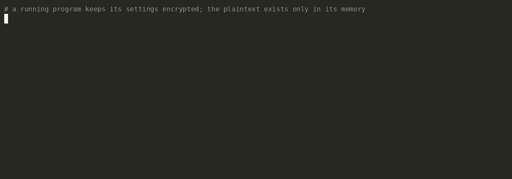

# N0xis

A reverse-engineering toolkit: disassembler, SSA decompiler, C++ class recovery and live-process
analysis for PE and ELF. Static files and running processes go through one pipeline, and every
answer is JSON a script can act on.

Three front ends share that core: the CLI, where a command answers with one JSON object (a `serve` session with a ready envelope, then one per request); a
desktop GUI in its own repository, **[n0xis-gui](https://github.com/Structio-labs/n0xis-gui)**; and
an MCP server, `n0xis-mcp` — 27 tools returning the same envelope over JSON-RPC on stdio.



<sub>A real run of [`examples/config-demo`](examples/config-demo): a program keeps its settings encrypted and decrypts them into memory; find the plaintext, arm a hardware watchpoint on it, and get the decompiled code that wrote it. Rerun it yourself with `demo.sh`.</sub>

```console
$ n0xis provenance trace --pid 181529 --addr 0x564e32cb7060 --kind write
```
```jsonc
"instruction_va": "0x564e32cb4266",   // the byte store that wrote the watched address
"function_va": "0x564e32cb4230",      // the function it sits in, on this build (see below)
"decompiled_context": [
  "rcx.3 = (uint32_t)((uint32_t)(uint32_t)*(uint8_t*)((rsi.1 + v2)) ^ (uint32_t)v1);",
  "*(uint8_t*)((rdi.1 + v2)) = (uint8_t)rcx.3;",   // ← the write
  "rcx.4 = (uint32_t)(v1 + (v1 * 0x2));",
  "v2 = (v2 + 0x1);",
  "v1 = (uint32_t)((v1 + (rcx.4 * 0x4)) + 0x7);"
]
```

In the source this is `config[i] = sealed[i] ^ key; key = key * 13 + 7;`: the two statements
`rcx.4 = v1 + v1 * 2` and `v1 = v1 + rcx.4 * 4 + 7` together are `v1 * 13 + 7`. The answer gives
addresses, not the names `config` and `decrypt_config`: names from the binary's symbols are not
carried into it yet. This build is gcc `-O2`, where `function_va` is the function's start; on clang
`-O2` and gcc `-O1` builds of the same source it is the loop head, answered `ok:true` with no note.
This run is on Linux; the last Windows run of `provenance trace` is in the [ledger](docs/VERIFICATION.md).

## What runs where

**yes**: every check agreed · **partial**: usable, with the gaps below · **wrong**: `ok:true` with wrong
results on measured inputs · **refused**: a typed error · **not yet**: no code path. Measured in October
2026 on programs built from known source, against the processor and independent tools.

| Format | Static file | Live process |
| --- | --- | --- |
| PE32+, PE32 (x86-64, x86, ARM64) | partial: the gaps and wrong answers below | Windows: not measured for this table |
| ELF64, ELF32 (x86-64, x86, AArch64, ARMv7) | partial: the gaps and wrong answers below; big-endian: decompile and RTTI refused | Linux x86-64: partial: the live entries below; other ISAs not measured |
| Mach-O, thin and universal | refused (`load-failed`) | not yet |
| WebAssembly | partial: the function list, disassembly, calls to and from a function, imports, exports, `profile` and `strings` (with each string's place in linear memory) agreed with `wasm-objdump` on every module measured; decompile, IR and the other commands that need the lift refused (`not-lifted`: the lift is stage 3) | not yet |
| Raw bytes (`--bytes`) | disassemble, cross-references, strings with a range; discover and decompile partial; `profile` and `rtti scan` refused | — |

| ISA | Disassemble | Discover functions | Decompile |
| --- | --- | --- | --- |
| x86-64 | yes | yes with unwind tables; partial without | partial |
| x86 (i386) | yes | partial: even with `.eh_frame`, GCC's padding and `.plt` listed as functions, dots in names rewritten, an end missing | partial |
| AArch64, little- and big-endian | yes | little-endian yes with `.eh_frame`; big-endian partial: misses functions `.eh_frame` declares; partial without; on PE `--pdata` is wrong | partial; big-endian refused |
| ARMv7 A32 | partial: no NEON, data in code decoded as code | partial | wrong: jump tables, tail calls |
| ARMv7 Thumb-2 (`--arch thumb`) | wrong: branch targets, IT conditions | partial: no names or ends | wrong: an IT-predicated return ends the function |
| WebAssembly | yes; a branch's target is a label depth, not given until stage 3 | yes: every body, its extent, index and name | refused (stage 3) |

- **Wrong with `ok:true`**: Itanium RTTI in a MinGW PE (reported absent), `--pdata` on ARM64 PE, long
  MinGW section names in `profile` (`/4`), the export list of an ELF shared object and the
  `.localalias` names it gives that object's functions, GCC's i386 padding and `.plt` block listed as
  functions, dots in symbol names printed as underscores (`__x86_get_pc_thunk_bx` for
  `__x86.get_pc_thunk.bx`), and big-endian AArch64 discovery missing functions its `.eh_frame` declares.
  The decompiler drops pass-through arguments, prints arithmetic shifts unsigned and 64-bit multiplies
  as 32-bit, can switch on or read a register it never assigns, on AArch64 can name the wrong string,
  on A32 (and in the same shape on AArch64) runs a countdown loop one iteration short, and on 32-bit
  x86 loses stack arguments and the high half of 64-bit results. Its `quality` field is not a
  correctness score. The full list, with counts, is in the [ledger](docs/VERIFICATION.md).
- **Missed, answered `ok` with less**: without unwind tables, functions reached only through vtables,
  the MSVC-ABI entry point and most of an ELF shared object; references held in absolute immediates,
  AArch64 `adrp`+`add` or `adr`, or the i386 GOT; Itanium secondary vtables, and every Itanium class
  of a stripped image; names that only the COFF symbol table holds. A PDB beside an x64 PE gave every
  start, name and end on the two lld-link images measured (35 of 35, 18 of 18).
- **Live** (Linux): `provenance trace` prints a written address as a string literal when the bytes
  there happen to be printable, and on some builds names the loop head as the function (above); the
  byte-pattern scan (`scan aob`) needs `--start`/`--size` to get past an unreadable region;
  `scan dissect` guesses field types; Windows-only commands refuse elsewhere.

## Install

Prebuilt binaries for Linux and Windows, the MCP server and `sha256sums.txt`: **[latest release](https://github.com/Structio-labs/N0xis/releases/latest)**.

```sh
curl -LO https://github.com/Structio-labs/N0xis/releases/latest/download/n0xis-linux-x86_64
curl -LO https://github.com/Structio-labs/N0xis/releases/latest/download/sha256sums.txt
sha256sum -c --ignore-missing sha256sums.txt
chmod +x n0xis-linux-x86_64 && mv n0xis-linux-x86_64 n0xis && ./n0xis --version
```

Or build it with stable Rust, on Linux or Windows: `cargo build --workspace --release`. `rust-toolchain.toml`
pins the channel only, and says how to build on Windows without the MSVC Build Tools.

## Quickstart

Every command prints **one** JSON object, argument errors included: `{"ok":true,"data":…,"meta":…}` or
`{"ok":false,"error":…}`. The two session servers are the exception: `serve` prints one envelope per
line, a ready envelope and then one for each request of its session, and `remote-serve` speaks its own line-by-line protocol to
the `--remote-cmd` side. Add `--pretty` to read it; the exit code is non-zero on failure. Only `--help` and
`--version` print plain text. The reference docs call the binary `n0x` (`ln -s n0xis n0x`).

```sh
n0xis doctor                                         # environment check
n0xis profile --file app.exe                         # triage: sections, exports, runtime hints
n0xis function discover --file app.exe --pdata       # functions from the x64 unwind table
n0xis decomp pseudo --file app.exe --addr 0x140012a00 --style ssa --pretty
n0xis xref to --file app.exe --addr 0x140012a00      # what calls or references it
n0xis rtti scan --file app.exe                       # C++ classes from RTTI
n0xis provenance trace --pid 4821 --addr 0x1a2b3c40 --kind write --pretty   # live: what wrote it
```

A command names its target with `--file`, `--pid`, `--snapshot`, `--remote-cmd` or `--bytes`; its `--help`
lists the ones it takes. Output is Unix plumbing: `n0xis function discover --file app.exe --pdata | jq -r '.data.functions[].va'`
feeds the next command. `n0xis guide` lists all 120 commands, generated from the binary, and a test fails the
build if this README, `MAP.md`, `CONCEPT.md` or `docs/CLI_COMMANDS.md` states another count. On Linux, with Yama `ptrace_scope=1`, reading another process needs
root or `CAP_SYS_PTRACE` unless it allows tracing, as `config-demo` does.

## What it does

- **Read an image**: disassembly, function discovery, cross-references, strings, section and export triage.
- **Decompile**: SSA, structured C-like output; `--explain` lists the rewrites it records, each with the
  pass that made it.
- **Recover names**: C++ classes from MSVC and Itanium RTTI, PDBs, exports, ELF symbols, .NET NativeAOT method
  maps, and a few runtime formats, LuaJIT 2.0 bytecode among them.
- **Work on a running process**: read, write and map memory; search it for values, byte patterns, structures
  and pointer paths, narrowing as values change; patch it through a journal that can undo each change.
- **Watch and explain**: software and hardware breakpoints, a cross-process call stack (Linux), and
  `provenance trace`, from a watchpoint hit to the statement that wrote the value.
- **Keep the work**: `.n0xt` tables, versioned annotations, a content-addressed cache, function and version diffing.

There is no machine-learned component in the core.

## How answers are checked

A claim counts only when a source outside N0xis agrees: a program built from known source and run on the
processor, the image's own tables, or an independent tool such as `llvm-objdump`, `readelf` or `eu-stack`.
[docs/VERIFICATION.md](docs/VERIFICATION.md) is the one place the numbers live, open gaps included. Three of
them, from October 2026:
- the decoder read 10 498 instructions on 10 PE and ELF images (x86-64, x86, AArch64) as `llvm-objdump` or GNU `objdump` does, every difference a documented alias;
- on Linux, 19 of 23 live operations matched `/proc/<pid>/mem`, `/proc/<pid>/maps`, `nm`, `objdump`, `eu-stack` or the target's own printed values; the other four are in the live entry above: the string literal in `provenance trace`, `scan aob` on its default regions, `scan dissect`'s types and the Windows-only refusal (the loop head was measured on `config-demo`, not among the 23);
- the decompiler's C, compiled beside its source and run on the same inputs, was right on 5 to 11 of 14 functions per image on 9 PE and ELF images, a first measurement: 33 of the 126 verdicts were not executed, because the output could not be run (24 read by hand, 9 judged incomplete from the placeholders the text holds), and a second pass did not reproduce the totals.

## Docs

- **[docs/CLI_COMMANDS.md](docs/CLI_COMMANDS.md)** — every command and the schema each emits, generated from the
  binary; arguments are in `n0xis guide` and `--help`, generated too.
- **[docs/VERIFICATION.md](docs/VERIFICATION.md)** — every check, its source and case count: proven, open, not claimed.
- **[oracle/README.md](oracle/README.md)** — targets whose answer is known before the question, and how to add one.
- **[CONCEPT.md](CONCEPT.md)** (architecture) · **[ROADMAP.md](ROADMAP.md)** (history, what is missing) ·
  **[MAP.md](MAP.md)** (the 17-crate layout) · **[docs/COMMUNITY_ROADMAP.md](docs/COMMUNITY_ROADMAP.md)** ·
  **[docs/PRODUCT_POLICY.md](docs/PRODUCT_POLICY.md)** · **[CONTRIBUTING.md](CONTRIBUTING.md)**

## License

N0xis is **source-available** software, developed under the Structio name.

- **Free for noncommercial use** — personal projects, research, education, CTFs, hobby reverse
  engineering, and use by noncommercial organizations, under the
  [PolyForm Noncommercial License 1.0.0](LICENSE).
- **Commercial use requires a paid license** — see [COMMERCIAL.md](COMMERCIAL.md).

Versions up to and including 0.2.1 were released under AGPL-3.0 and remain available under
those terms. This license applies to 0.3.0 and later.

Not sure whether your use case is commercial? Open an issue or email <structio.dev@gmail.com> —
I'd rather answer a question than chase a violation.
